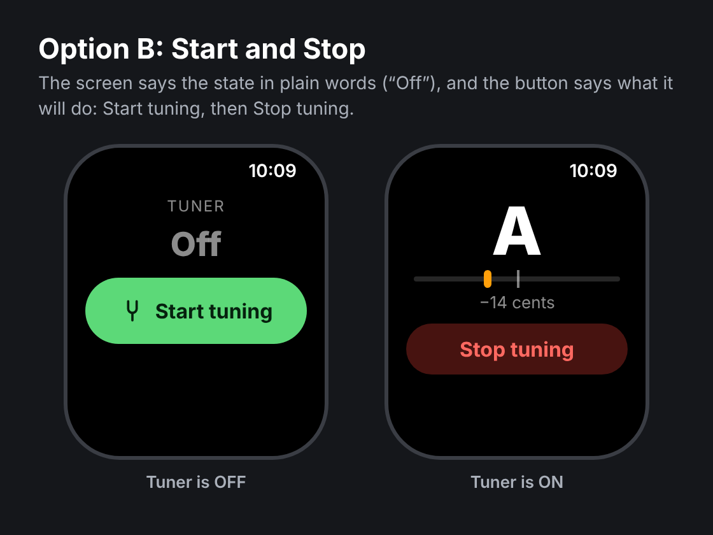
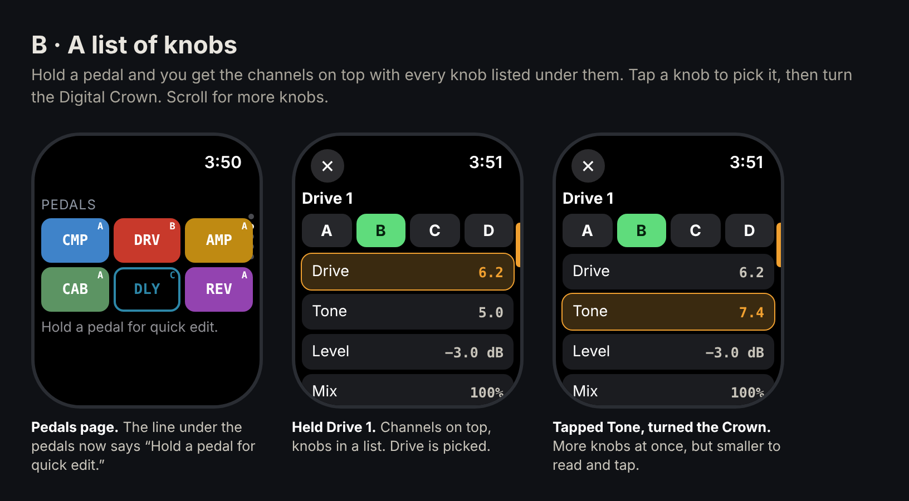

# The Apple Watch app: what was chosen, and the pictures it was chosen from

The watch app's code is mobile/targets/watch (Swift) and its conversation
with the phone is shared/watch-link.mjs. Work on it that waits for a build
is in docs/pending. This folder keeps the pictures a choice was made from,
so the choice is on record.

## The tuner page: Start tuning and Stop tuning

`tuner-start-stop.png` is the mockup Justin picked on 11 November 2026, of
three: "Go with option B for the watch I like that one."

Why it changed: the off screen was one button that said "Tuner on" while
the tuner was off, and he read it as the state: "where it says tuner on I
feel like that means it on."

So the screen says what the tuner IS, and the buttons say what a tap will
DO:

- **Off:** the small TUNER line, then the word "Off", big and grey, then one
  large green button with the tuning fork, "Start tuning" (the app's green,
  #5CD978, with near-black words, #06210E). No "Tap to tune." line, and
  nothing on the screen says "on".
- **On:** the note, the needle and the cents line as they were, then
  "Stop tuning", red (red words, #FF6961, on a red-tinted fill, 255, 69, 58
  at 28%), where "Tuner off" was.
- Never "Tuner on" or "Tuner off" as a button's words again.
- VoiceOver reads the buttons by their words, and "Off" as "Tuner is off".

Nothing about what the tuner does changed with the words: the same two
requests to the phone, nothing until it is tapped, and off when its page is
left or hidden (docs/pending/README.md has the rest, and the setting that
lets it stay on).

The picture is a drawing, not a screenshot: the real page is in
mobile/targets/watch/Pages.swift (`TunerPage`), its words in Model.swift
(`TunerWords`), and CI's own pictures of it are watch.yml's page-3.png and
tuner-on.png.

## Quick edit: a held pedal's channels, with its knobs in a list

`quick-edit-list.png` is the mockup Justin picked on 12 November 2026, of
three: "For the watch, mock up B."

What he asked for: "On the watch, we have pushed to hold on the channels to
switch amps. Can we set up quick edits on that as well? And change the name
to hold to quick edit? give me some mockups of that."

The three were: A, one knob at a time, filling the screen, with a swipe
for the next and the channels along the bottom; B, the channels in one row
with every knob in a list under them; and C, today's big channel buttons
with a second screen of four knobs a swipe away. He chose B.

What B is, and what the watch does (Pages.swift, `QuickSheet`):

- Under the pedals: "Hold a pedal for quick edit." where the iPhone offers
  it, and "Hold a pedal for its channels." everywhere else, as before.
- Holding a pedal opens a sheet: the block's name, its channels A to D in
  one row (the one it is on lit green), then its knobs, one row each, the
  name on the left and the value on the right.
- A tap picks a row: an amber outline (#F5A623) and an amber value. The
  Digital Crown turns the picked knob. The first knob is picked when the
  sheet opens.
- Where the iPhone does not offer quick edit, the sheet is the channel
  picker it always was.

Two things the drawing shows that the watch does not do:

- **No Level row.** The drawing lists "Level, -3.0 dB". A block's Level is
  never a knob in the app (a level turned to the bottom by a slip is a
  silent preset), so the watch lists what the iPhone's Edit page draws as
  knobs and leaves the Level out.
- **The numbers are written as Edit writes them**, to two places with the
  unit after a space ("6.20", "100.00 %"), where the drawing has "6.2" and
  "100%".

The picture is a drawing, not a screenshot. What the iPhone sends and what
gates it are in docs/pending/README.md ("Quick edit on a held pedal") and
shared/watch-link.mjs; CI's own pictures of it are watch.yml's
quick-line.png and quick.png.
